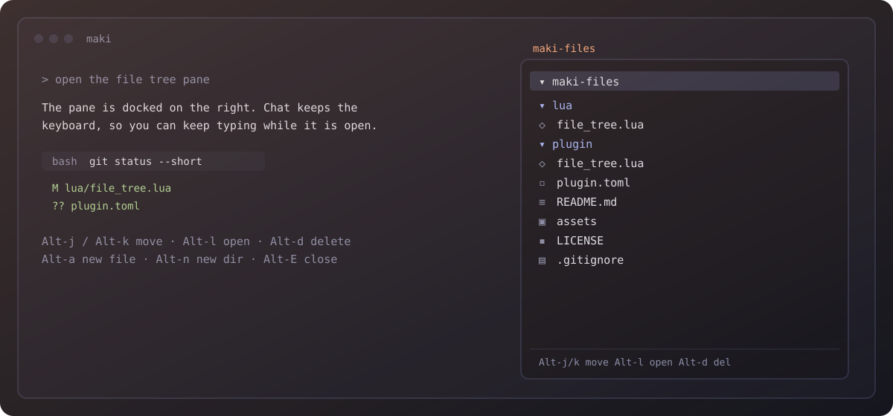

# maki-files



A file manager pane for [Maki](https://maki.sh): a docked tree on the right edge
with navigation, create/rename/delete, and open-in-`$EDITOR`.

The pane **never takes keyboard focus**. Plain letters stay in the chat input, so
you can keep typing a prompt with the tree open; the pane answers only to
Alt-prefixed keys and mouse clicks.

- Lazy directory loading, directories first, `.`-files toggled with a key.
- Create, rename and delete files and directories, with a one-key confirmation
  for deletes.
- Refuses writes while the session is in plan mode.
- Survives `SessionCwdChanged` / `FileIndexReady`: the tree rebuilds itself.
- Caps a directory at 2000 entries so expanding `node_modules` cannot hang the UI.

## Install

```lua
-- global init.lua
maki.pack.add({
  { src = "https://github.com/ehalil2004/maki-files", version = "v1.1.0" },
})
```

Maki asks once before installing and once for the permissions below. Then
`/reload` (or restart) and press `Alt-E`.

## Keys

| Key | Action |
|---|---|
| `Alt-j` / `Alt-k` (`Alt-↓` / `Alt-↑`) | move |
| `Alt-l` | expand a directory, or open a file in `$EDITOR` |
| `Alt-h` | collapse a directory, or jump to its parent |
| `Alt-a` | new file |
| `Alt-n` | new directory |
| `Alt-r` | rename |
| `Alt-d` | delete (`y` confirms, a directory is removed recursively) |
| `Alt-s` | show/hide dot-files |
| `Alt-u` | re-read the tree |
| `Alt-i` | key help |
| `Alt-E` | open/close the pane (or `/files`) |

Mouse: clicking a directory expands or collapses it, clicking a file opens it.

Keys are deliberately chosen to avoid Maki's own `Alt+←/→` (word motion),
`Alt+Enter` (newline), `Alt+O` (edit input) and `Alt+T` (thinking).

## Permissions

| Permission | Why |
|---|---|
| `fs_read` | `maki.fs.dir`, `maki.fs.metadata` — listing directories |
| `fs_write` | `write`, `mkdir`, `rename`, `rm` — the file operations you trigger |
| `session_read` | `maki.plan.read` — the pane refuses writes in plan mode |
| `run` | `maki.fn.jobstart` — starts your GUI editor, only when `open_cmd` is set |

No network and no agent calls. `run` exists solely for the optional
`open_cmd` launcher below; without it the pane never starts a process.

## Config

The defaults are `width = 40`, `toggle_key = "<M-e>"`, `show_hidden = false`.
To change them, install with a custom entry point:

```lua
maki.pack.add({
  {
    src = "https://github.com/ehalil2004/maki-files",
    version = "v1.1.0",
    data = { width = 52, toggle_key = "<C-b>" },
  },
}, {
  load = function(package)
    require("file_tree").setup(package.spec.data)
  end,
})
```

### GUI editors

`Alt-l` opens a file through `maki.ui.open_editor`, which reads `$VISUAL` or
`$EDITOR` and **suspends the TUI** until the editor exits. That needs an editor
that blocks: `notepad`, `nvim`, or `code --wait`.

GUI apps without a blocking mode (`zed`, most Electron editors) return at once,
so the TUI snaps back while the window opens. Point `open_cmd` at them instead:
the file is opened by a background process and the TUI is never torn down.

```lua
maki.pack.add({
  {
    src = "https://github.com/ehalil2004/maki-files",
    version = "v1.1.0",
    data = {
      open_cmd = '"C:\Users\you\AppData\Local\Programs\Zed\Zed.exe"',
    },
  },
}, {
  load = function(package)
    require("file_tree").setup(package.spec.data)
  end,
})
```

Quotes are honoured, so a path with spaces stays one argument; the file path is
appended last. If the command fails to start, the pane says so and falls back to
`$EDITOR`.

The module is also callable directly: `require("file_tree").setup{...}`,
`.toggle()`, `.open()`, `.close()`, `.refresh()`.

## Notes

- `.gitignore` is **not** applied — only dot-files are hidden, because
  `maki.fs.dir` has no gitignore mode.
- New names are single path components; separators (`/`, `\`) are rejected.
- Deleting the workspace root is refused.
- The pane is a split on the right edge; `width` is in columns.

## Development

Hand-install without git, which is trusted and needs no approval prompt:

```text
<maki-data>/site/pack/dev/start/maki-files/
```

On Windows `<maki-data>` is `%APPDATA%\maki`, on Linux/macOS
`~/.local/share/maki`. Then `/reload` after every edit.

## License

MIT — see [LICENSE](LICENSE).
